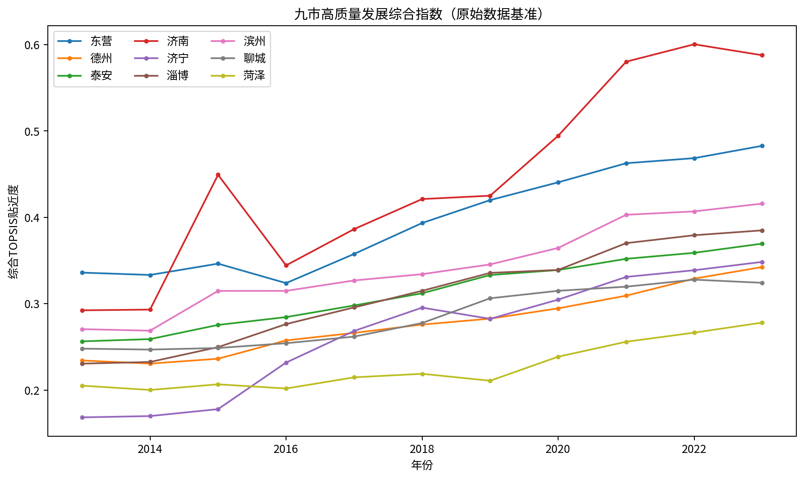
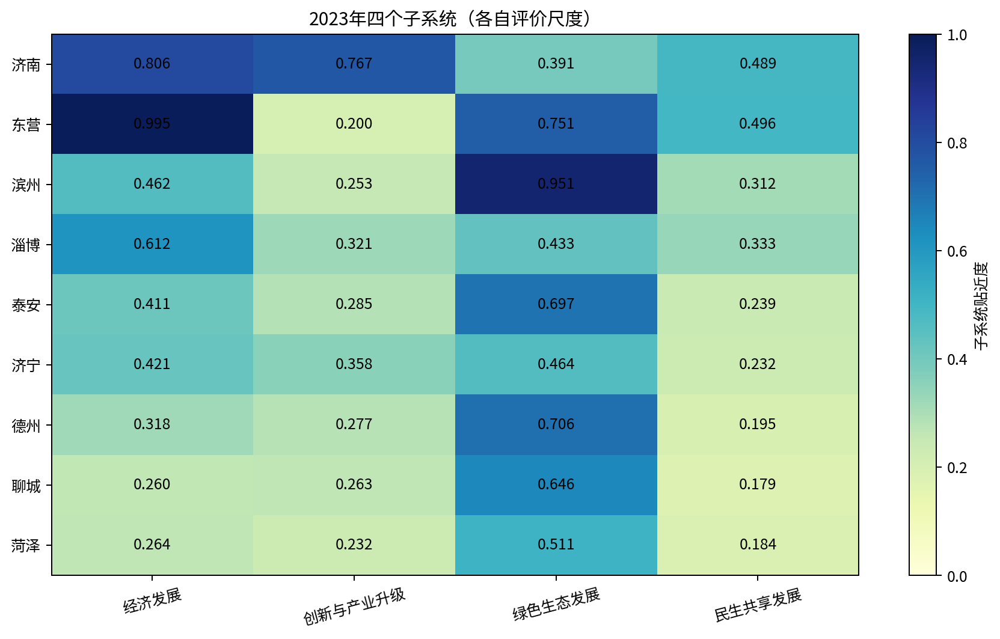
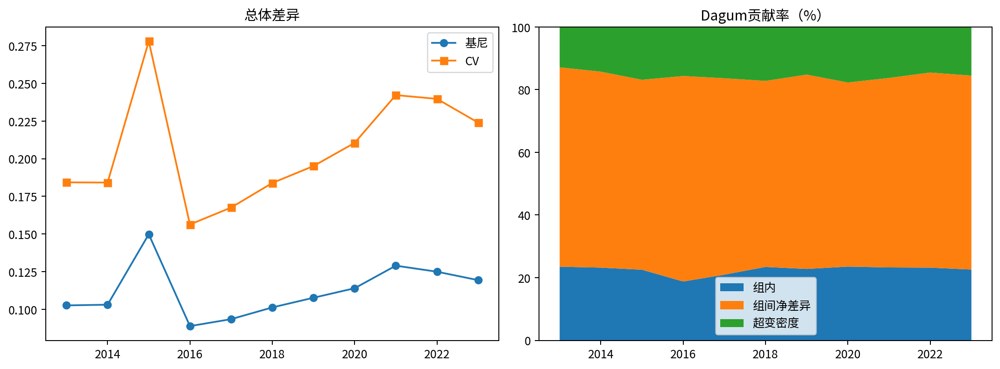
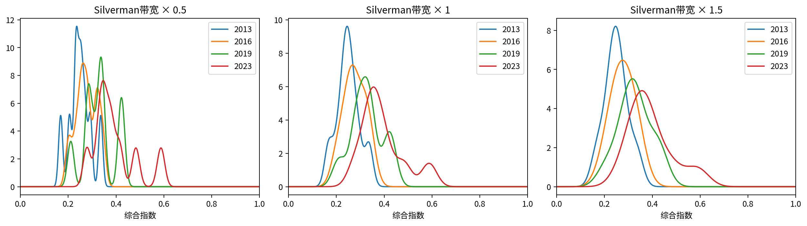
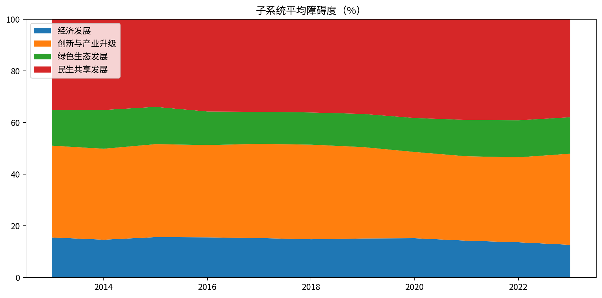

# 山东省沿黄九市高质量发展水平、区域差异及障碍因素分析报告

研究期：2013—2023年。材料：用户提供《思路.docx》及《用于数据清洗的指标汇总13-23.xlsx》。本报告是可复算的实证分析稿，不代替统计来源核验或论文文献综述。

## 一、主要发现与可信度

原始数据基准下，九市综合指数均值由2013年的0.2490升至2023年的0.3927，相对提升57.67%。总体基尼由0.1026变为0.1193，CV由0.1843变为0.2240。这些是评价模型中的相对位置变化，不是经济增长率或因果效应。

2023年排序：济南（0.5877）、东营（0.4828）、滨州（0.4159）、淄博（0.3849）、泰安（0.3695）、济宁（0.3484）、德州（0.3424）、聊城（0.3242）、菏泽（0.2781）。

结论等级：基于现有表格的可复算结果。旅游消费异常值、能耗单位和排放数据连续性尚待核验；应结合后文敏感性结果使用，不能直接作为已核实的最终论文结论。

## 二、数据审计与清洗边界

共99条城市—年份观测，11个数值指标，无空值、无重复城市年份，城市与年份组合完整。仅清理列名空格、核对数值类型并排序；基准不插补、不缩尾、不改原始数值。医疗与图书指标分别已按每千人、每万人计量，沿用实际表头，未误作总量。专利和景区仍为总量，缺少人口分母，存在规模效应。

济南2015年旅游消费11.9，相邻年份为0.96、1.34，可能影响全样本极值及熵权；不能凭外观认定小数点错误。德州2020年旅游消费为0，既不自动当缺失，也不认定为真实零消费。九市2023年颗粒物排放量全部与2022年一致，可能存在沿用值。单位GDP能耗数值约1075.7—5383.7，表内无单位和分母解释，需核实是否实际为能耗总量。若指标实为总量，绿色解释必须重新评估。

部分人均GDP、收入和产业占比在2015、2016或2019年前后跳变。可能来自统计修订、行政区划或口径变化，现有文件不足以判断；不能把这些跳变全部解释为实际发展变化。收入、GDP未提供价格平减资料，本报告沿用名义值；跨期提升包含价格因素。旅游指标的单位及“人均”分母也未注明。无外部统计资料交叉验证。

核查清单共23条，见Excel“数据核查清单”；核查不等于判定错误。未进行机械异常剔除，以免删除疫情期等真实波动。

## 三、方法、公式与复算口径

全部99条观测共同确定极差标准化基准。正向 z=(x−min)/(max−min)，负向 z=(max−x)/(max−min)，单位GDP能耗与颗粒物排放为负向，其余正向。熵权 p=z/Σz，0ln0按0处理，e=−Σp ln p/ln99，w=(1−e)/Σ(1−e)。CRITIC采用标准化值的总体标准差和Pearson相关：C_j=σ_jΣ_k(1−r_jk)，再归一化。

博弈组合：令W两行分别为熵权和CRITIC权重，A=WWᵀ，解Aα=diag(A)，再将非负系数归一化；α=(0.636119, 0.363881)。实际使用：经典博弈均衡线性方程 Aα=diag(A)，系数归一化。若未来数据产生负系数，程序使用单纯形约束残差最小化并明确披露，不能将其称作经典无约束均衡。

TOPSIS采用加权极差标准化矩阵v=z·w，固定全样本正负理想点v⁺、v⁻，以欧氏距离计算H=D⁻/(D⁺+D⁻)。这是先乘权重再求平方距离的版本；距离中的有效系数为w²，不混用Σw(z−z⁺)²的另一版本。各子系统内部权重重新归一化，各自使用全样本理想点。综合指数不等于子系统指数的加权平均；不同子系统有不同理想目标，不能把其数值差直接解释为现实单位差距。

Dagum按每年九市等权分解。G=Σ_iΣ_j|H_i−H_j|/(2n²μ)。每组内绝对差除以2n²μ得到组内贡献；每对区域的绝对差和除以n²μ得到组对总贡献，其中差值和的绝对值除以n²μ为组间净贡献，余项为超变密度。等价于Dagum的G_jh(p_j s_h+p_h s_j)D_jh与(1−D_jh)分配；超变密度刻画分布交叉。每年检验G=G_w+G_nb+G_t。CV=总体标准差/均值（ddof=0）；与基尼趋势比较只作辅助，不是独立因果检验。

地理三区为研究者分析分组：鲁中引领区（济南、泰安、淄博），鲁北生态转型区（东营、滨州、德州），鲁西及鲁西南协同发展区（菏泽、济宁、聊城）。不是官方行政划分，组间比较还受分组方式影响。

核密度在2013、2016、2019、2023年各取9个城市，不跨年池化。Gaussian核，Silverman带宽h=0.9min(s,IQR/1.34)n^(−1/5)，s为样本标准差，IQR为零时回退s；采用[0,1]边界反射，比较0.5h、h和1.5h。每期仅9个样本，不据多峰断言极化。障碍度O_j=w_j(1−z_j)/Σw_k(1−z_k)×100%，子系统相加，区域和九市总体取城市障碍度算术平均；不是先聚合原始指标再计算障碍度。

## 四、权重与发展水平

| 指标 | 子系统 | 熵权 | CRITIC权重 | 组合权重 |
| --- | --- | --- | --- | --- |
| 单位GDP能耗 | 绿色生态发展 | 0.0563 | 0.1635 | 0.0953 |
| 绿化覆盖率 | 绿色生态发展 | 0.0394 | 0.1320 | 0.0731 |
| 颗粒物排放量 | 绿色生态发展 | 0.0232 | 0.1021 | 0.0519 |
| 人均GDP | 经济发展 | 0.0839 | 0.0848 | 0.0842 |
| 第三产业占GDP的比重（%） | 创新与产业升级 | 0.0542 | 0.1014 | 0.0714 |
| 专利申请授权数 | 创新与产业升级 | 0.2288 | 0.0633 | 0.1686 |
| 城镇居民人均可支配收入 | 经济发展 | 0.0724 | 0.0721 | 0.0723 |
| 每千人医疗机构床位数（床/每千人） | 民生共享发展 | 0.0608 | 0.0695 | 0.0639 |
| 每万人公共图书馆藏书量 | 民生共享发展 | 0.1390 | 0.0791 | 0.1172 |
| A级旅游景区数量 | 创新与产业升级 | 0.0693 | 0.0834 | 0.0744 |
| 旅游人均总消费 | 民生共享发展 | 0.1727 | 0.0489 | 0.1276 |

子系统全局权重合计：创新与产业升级31.44%；民生共享发展30.88%；绿色生态发展22.03%；经济发展15.65%。客观赋权衡量样本中的区分信息，不代表政策重要性或因果贡献。

### 年度均值与演变

| year | 综合指数 | 经济发展 | 创新与产业升级 | 绿色生态发展 | 民生共享发展 |
| --- | --- | --- | --- | --- | --- |
| 2013 | 0.2490 | 0.2283 | 0.1256 | 0.5119 | 0.1182 |
| 2014 | 0.2482 | 0.2683 | 0.1339 | 0.4792 | 0.1161 |
| 2015 | 0.2783 | 0.2556 | 0.1488 | 0.5282 | 0.1677 |
| 2016 | 0.2766 | 0.2705 | 0.1595 | 0.5565 | 0.1494 |
| 2017 | 0.2973 | 0.3068 | 0.1761 | 0.5846 | 0.1820 |
| 2018 | 0.3159 | 0.3491 | 0.1969 | 0.5971 | 0.2036 |
| 2019 | 0.3268 | 0.3517 | 0.2433 | 0.5929 | 0.2133 |
| 2020 | 0.3478 | 0.3692 | 0.2995 | 0.5961 | 0.2170 |
| 2021 | 0.3760 | 0.4331 | 0.3412 | 0.6003 | 0.2460 |
| 2022 | 0.3862 | 0.4665 | 0.3461 | 0.6044 | 0.2676 |
| 2023 | 0.3927 | 0.5053 | 0.3285 | 0.6166 | 0.2954 |

经济发展：九市均值由0.2283变为0.5053，2023年最高为东营（0.9949）。

创新与产业升级：九市均值由0.1256变为0.3285，2023年最高为济南（0.7672）。

绿色生态发展：九市均值由0.5119变为0.6166，2023年最高为滨州（0.9508）。

民生共享发展：九市均值由0.1182变为0.2954，2023年最高为东营（0.4960）。

创新子系统均值2023年较2022年回落，表中专利授权数九市均下降；这是指标层面的共同变化，尚不能区分授权周期、统计调整或实际创新变化。济南绿色子系统相对经济与创新表现偏弱，东营则呈经济与绿色突出、创新指标偏弱的结构。滨州绿色优势依赖现有能耗口径，应先核实后作政策解释。

### 2023年城市水平及排名

| city | 综合指数 | 年度排名 | 经济发展 | 创新与产业升级 | 绿色生态发展 | 民生共享发展 |
| --- | --- | --- | --- | --- | --- | --- |
| 济南 | 0.5877 | 1 | 0.8057 | 0.7672 | 0.3908 | 0.4889 |
| 东营 | 0.4828 | 2 | 0.9949 | 0.1997 | 0.7512 | 0.4960 |
| 滨州 | 0.4159 | 3 | 0.4618 | 0.2526 | 0.9508 | 0.3116 |
| 淄博 | 0.3849 | 4 | 0.6118 | 0.3208 | 0.4328 | 0.3334 |
| 泰安 | 0.3695 | 5 | 0.4106 | 0.2850 | 0.6967 | 0.2385 |
| 济宁 | 0.3484 | 6 | 0.4209 | 0.3583 | 0.4635 | 0.2324 |
| 德州 | 0.3424 | 7 | 0.3176 | 0.2774 | 0.7062 | 0.1945 |
| 聊城 | 0.3242 | 8 | 0.2603 | 0.2633 | 0.6459 | 0.1789 |
| 菏泽 | 0.2781 | 9 | 0.2639 | 0.2322 | 0.5112 | 0.1841 |

各市2013—2023完整得分、年度排名、四子系统得分见结果工作簿。采用统一基准和固定权重保障本样本跨年可比；加入未来年份后重算极值或权重会改变历史得分。

### 三区域均值比较

| year | 区域 | 综合指数 | 经济发展 | 创新与产业升级 | 绿色生态发展 | 民生共享发展 |
| --- | --- | --- | --- | --- | --- | --- |
| 2013 | 鲁中引领区 | 0.2598 | 0.2839 | 0.1869 | 0.4136 | 0.1758 |
| 2013 | 鲁北生态转型区 | 0.2802 | 0.3080 | 0.0678 | 0.6456 | 0.1371 |
| 2013 | 鲁西及鲁西南协同发展区 | 0.2071 | 0.0929 | 0.1220 | 0.4764 | 0.0416 |
| 2023 | 鲁中引领区 | 0.4474 | 0.6094 | 0.4577 | 0.5067 | 0.3536 |
| 2023 | 鲁北生态转型区 | 0.4137 | 0.5914 | 0.2432 | 0.8027 | 0.3340 |
| 2023 | 鲁西及鲁西南协同发展区 | 0.3169 | 0.3150 | 0.2846 | 0.5402 | 0.1985 |

区域均值为三市等权平均，不按人口或GDP加权。领先区域并不意味着其每个城市都领先其他区域，须结合超变密度理解分布交叉。

## 五、区域差异及动态分布

| year | 总体基尼 | 组内贡献 | 组间净贡献 | 超变密度贡献 | 组内贡献率 | 组间净贡献率 | 超变密度贡献率 | 变异系数 |
| --- | --- | --- | --- | --- | --- | --- | --- | --- |
| 2013 | 0.1026 | 0.0241 | 0.0653 | 0.0132 | 0.2350 | 0.6362 | 0.1287 | 0.1843 |
| 2014 | 0.1030 | 0.0239 | 0.0644 | 0.0147 | 0.2321 | 0.6252 | 0.1427 | 0.1842 |
| 2015 | 0.1498 | 0.0338 | 0.0908 | 0.0252 | 0.2253 | 0.6062 | 0.1685 | 0.2780 |
| 2016 | 0.0888 | 0.0167 | 0.0582 | 0.0139 | 0.1878 | 0.6557 | 0.1565 | 0.1563 |
| 2017 | 0.0934 | 0.0196 | 0.0585 | 0.0153 | 0.2097 | 0.6267 | 0.1636 | 0.1675 |
| 2018 | 0.1012 | 0.0237 | 0.0601 | 0.0174 | 0.2343 | 0.5937 | 0.1721 | 0.1839 |
| 2019 | 0.1076 | 0.0245 | 0.0667 | 0.0164 | 0.2279 | 0.6200 | 0.1521 | 0.1951 |
| 2020 | 0.1140 | 0.0268 | 0.0669 | 0.0202 | 0.2353 | 0.5875 | 0.1772 | 0.2105 |
| 2021 | 0.1289 | 0.0300 | 0.0780 | 0.0210 | 0.2327 | 0.6047 | 0.1626 | 0.2422 |
| 2022 | 0.1249 | 0.0290 | 0.0778 | 0.0182 | 0.2320 | 0.6226 | 0.1454 | 0.2397 |
| 2023 | 0.1193 | 0.0270 | 0.0739 | 0.0185 | 0.2260 | 0.6189 | 0.1552 | 0.2240 |

2023年差异来源中组间净贡献最大。基尼与CV的11个年度水平相关系数为0.9957。需逐年看共同变化及拐点，相关系数高仅表明两项离散度测度在本样本走势接近，不是显著性或独立样本验证。四个子系统逐年Dagum分解也已导出，可用于扩展比较。

总体基尼并非假定为单调过程：11年中上升7次、下降3次，趋势描述应同时交代阶段波动。

2013年综合指数中位数0.2479，取值范围[0.1683, 0.3360]，总体标准差0.0459。

2016年综合指数中位数0.2764，取值范围[0.2018, 0.3444]，总体标准差0.0432。

2019年综合指数中位数0.3331，取值范围[0.2108, 0.4250]，总体标准差0.0638。

2023年综合指数中位数0.3695，取值范围[0.2781, 0.5877]，总体标准差0.0879。

从图4可见主峰总体右移，2023年右尾延伸更明显，与均值提高及离散度扩大相符。0.5倍带宽出现较多小峰，1.5倍带宽明显平滑，说明峰数对平滑参数敏感，不能认定形成稳定的双极或多极结构。

核密度图与带宽敏感性图见图4。应结合均值、基尼和城市实际位置解释：曲线位置和峰形受带宽显著影响，不能凭九个城市的平滑曲线识别稳定的极化机制。反射修正降低有界得分的边界泄漏，细节见“核密度带宽.csv”。

## 六、障碍因素及差异化路径

2013年九市平均前三项障碍：专利申请授权数 20.90%；旅游人均总消费 15.89%；每万人公共图书馆藏书量 12.87%。

2016年九市平均前三项障碍：专利申请授权数 21.80%；旅游人均总消费 16.44%；每万人公共图书馆藏书量 13.25%。

2019年九市平均前三项障碍：专利申请授权数 23.40%；旅游人均总消费 17.97%；每万人公共图书馆藏书量 12.77%。

2023年九市平均前三项障碍：专利申请授权数 23.81%；旅游人均总消费 21.65%；每万人公共图书馆藏书量 11.62%。

基准旅游指标因济南2015年极值11.9而使多数城市距理想点较远，这会抬高其障碍度的相对意义。高障碍排序同时受权重和标准化目标影响，必须在旅游口径核实后复算，不宜直接归因于旅游发展不足。

### 2023年城市前三项障碍

| 城市 | 第一障碍 | 第二障碍 | 第三障碍 |
| --- | --- | --- | --- |
| 东营 | 专利申请授权数 34.98% | 旅游人均总消费 26.39% | 第三产业占GDP的比重（%） 10.03% |
| 德州 | 专利申请授权数 22.92% | 旅游人均总消费 19.38% | 每万人公共图书馆藏书量 13.28% |
| 泰安 | 专利申请授权数 25.40% | 旅游人均总消费 19.02% | 每万人公共图书馆藏书量 15.46% |
| 济南 | 旅游人均总消费 31.60% | 单位GDP能耗 21.37% | 绿化覆盖率 11.94% |
| 济宁 | 专利申请授权数 22.50% | 旅游人均总消费 19.13% | 每万人公共图书馆藏书量 15.13% |
| 淄博 | 专利申请授权数 24.15% | 旅游人均总消费 19.79% | 单位GDP能耗 16.01% |
| 滨州 | 专利申请授权数 28.93% | 旅游人均总消费 23.16% | 每万人公共图书馆藏书量 12.19% |
| 聊城 | 专利申请授权数 22.98% | 旅游人均总消费 18.88% | 每万人公共图书馆藏书量 14.30% |
| 菏泽 | 专利申请授权数 21.84% | 旅游人均总消费 17.49% | 每万人公共图书馆藏书量 14.70% |

### 2023年子系统障碍与三区差异

| 区域 | 经济发展 | 创新与产业升级 | 绿色生态发展 | 民生共享发展 |
| --- | --- | --- | --- | --- |
| 鲁中引领区 | 10.6428 | 29.7552 | 21.5595 | 38.0425 |
| 鲁北生态转型区 | 10.8125 | 43.8120 | 7.2596 | 38.1159 |
| 鲁西及鲁西南协同发展区 | 16.1994 | 32.3681 | 13.5254 | 37.9070 |

鲁中引领区的平均主要短板为旅游人均总消费（23.47%）和专利申请授权数（20.06%）。可优先核查这两项供给、统计质量及城市内部差异，再配置改善资源；不能将高障碍度解释为提高该指标即可产生相同比例的综合发展收益。

鲁北生态转型区的平均主要短板为专利申请授权数（28.94%）和旅游人均总消费（22.98%）。可优先核查这两项供给、统计质量及城市内部差异，再配置改善资源；不能将高障碍度解释为提高该指标即可产生相同比例的综合发展收益。

鲁西及鲁西南协同发展区的平均主要短板为专利申请授权数（22.44%）和旅游人均总消费（18.50%）。可优先核查这两项供给、统计质量及城市内部差异，再配置改善资源；不能将高障碍度解释为提高该指标即可产生相同比例的综合发展收益。

政策含义：经济维度兼顾收入与生产率，创新维度关注专利质量和成果转化而非单纯数量，绿色维度先核实能耗口径并推进单位产出节能减排，民生维度关注床位和图书服务可及性。鲁中应强化创新成果扩散和都市圈公共服务协作；鲁北应结合能源产业转型和生态约束提升增长质量；鲁西及鲁西南可加强创新资源承接和基本公共服务。上述为指标诊断导向的建议，仍需财政、人口、产业和政策资料支持具体项目选择。

## 七、异常值敏感性与结果边界

对济南2015年旅游值以相邻年份均值1.15作假设插值；对德州2020年以相邻年份均值0.365作假设插值；分别与联合插值、剔除旅游指标、全样本旅游1%—99%缩尾比较。每种情景独立重算标准化、熵权、CRITIC、组合权重和理想点。剔除情景将旅游标准化列置零，熵权及CRITIC均不计其信息，数学上等价于移除该指标。结果不是确认的修正值。

| 情景 | 旅游组合权重 | 2013均值 | 2023均值 | 2013基尼 | 2023基尼 | 2023排名Spearman | 2023最大名次变化 |
| --- | --- | --- | --- | --- | --- | --- | --- |
| 原始数据 | 0.1276 | 0.2490 | 0.3927 | 0.1026 | 0.1193 | 1.0000 | 0 |
| 济南2015旅游插值 | 0.0915 | 0.2590 | 0.4252 | 0.1078 | 0.1402 | 0.9833 | 1 |
| 德州2020旅游插值 | 0.1486 | 0.2418 | 0.3792 | 0.1022 | 0.1177 | 1.0000 | 0 |
| 两处旅游联合插值 | 0.1098 | 0.2580 | 0.4261 | 0.1103 | 0.1441 | 0.9500 | 2 |
| 剔除旅游指标 | 0.0000 | 0.2539 | 0.4189 | 0.1087 | 0.1381 | 1.0000 | 0 |
| 旅游全样本1%-99%缩尾 | 0.1114 | 0.2564 | 0.4224 | 0.1091 | 0.1419 | 0.9500 | 2 |

联合插值下，2023年城市排名与基准Spearman相关系数为0.9500，最大名次变化2位。不同情景的指数水平因基准及权重变化不宜当作同一量尺直接作差；应重点比较城市排序和差异方向。

各旅游敏感性情景的期末—期初基尼变化方向一致。

旅游核查不能解决能耗口径、颗粒物沿用值或统计区划跳变的不确定性。未按猜测修改这些值，也未为2013年不明小数精度虚构来源。下一步应回查原始统计年鉴、统一能耗及旅游消费单位、确认2019年前后GDP口径与济南区划可比性，补入人口以检验专利/景区规模效应、补入价格指数以区分实际与名义提升，再冻结论文最终版本。

## 八、复现与验证

代码入口analysis.py；Python 3.11或3.12，使用requirements.txt中的固定依赖，执行python analysis.py即可从data/input.xlsx重算全部表格、图像、Markdown及Word报告。输入路径和输出路径可通过--input、--output指定。原文件随包保留，SHA256见运行核验.json。

已执行的验证：99条得分范围、权重归一、障碍度加总、55组Dagum加总及贡献率全部通过。独立单元测试覆盖已知Dagum解析值、分解的排列与尺度不变性、TOPSIS理想点，以及核密度面积；测试结果由终端记录。无随机估计，无外部API依赖，无耦合协调模型。

本报告没有对城市样本作总体抽样推断，没有估计因果效应，没有引用未经核验的外部文献。报告与全部中间数据均由同一脚本生成，便于补充核实数据后重跑。

## 图表

